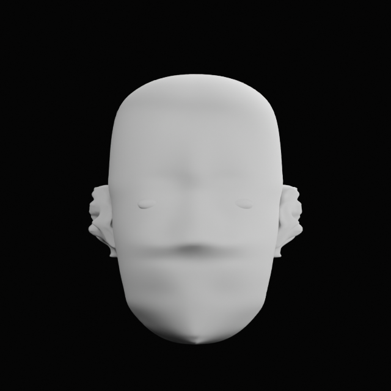
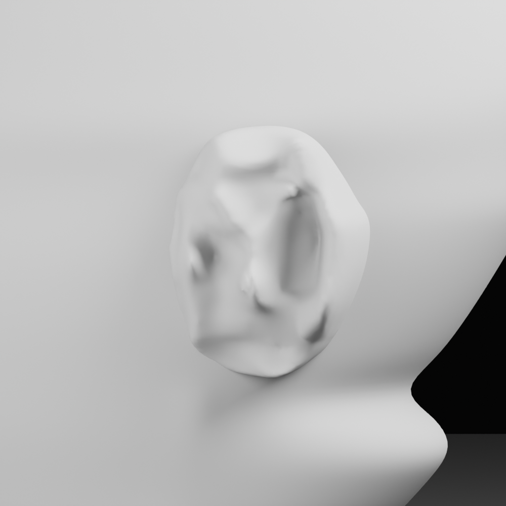
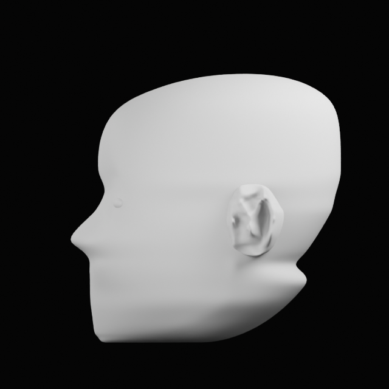
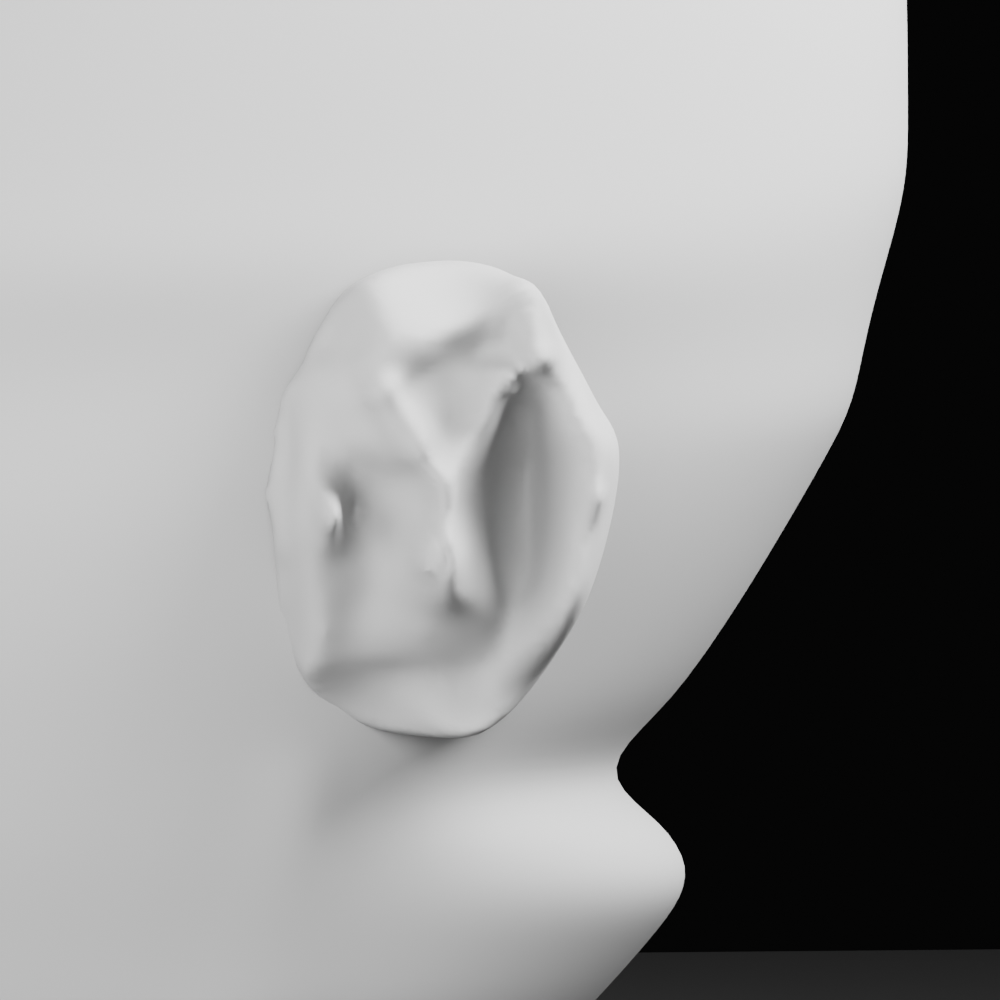
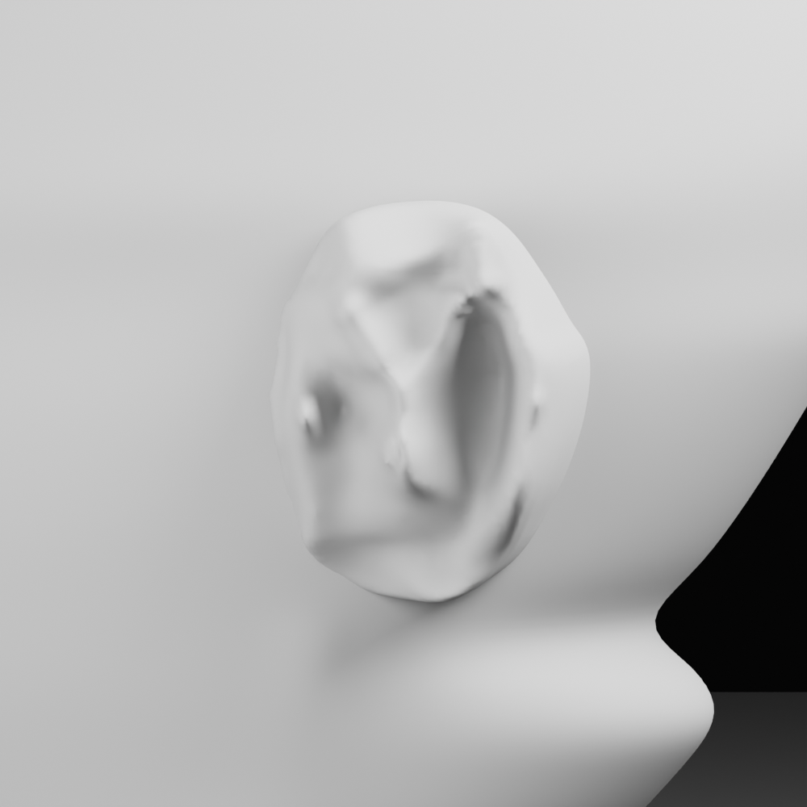
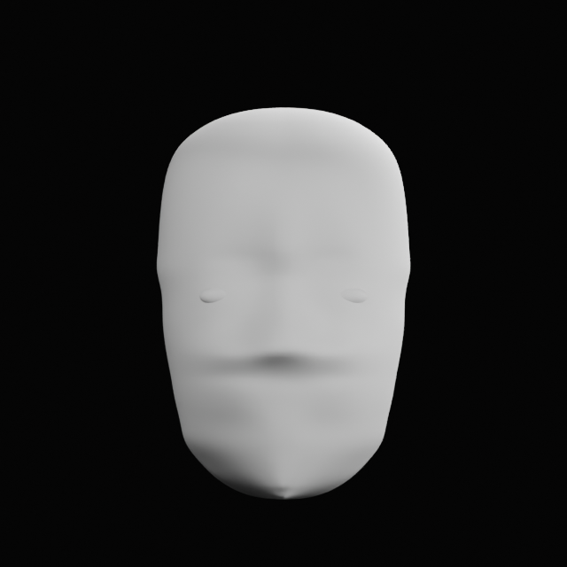
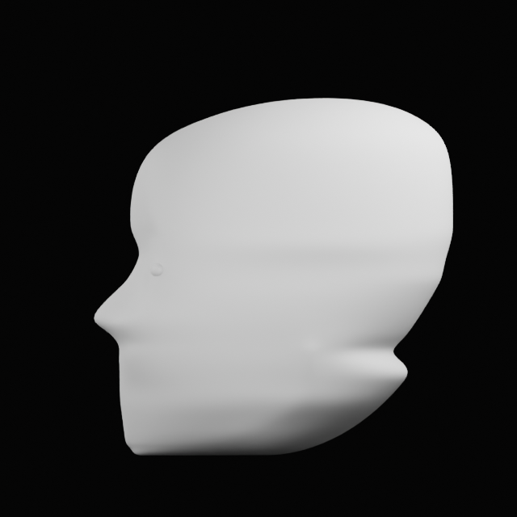
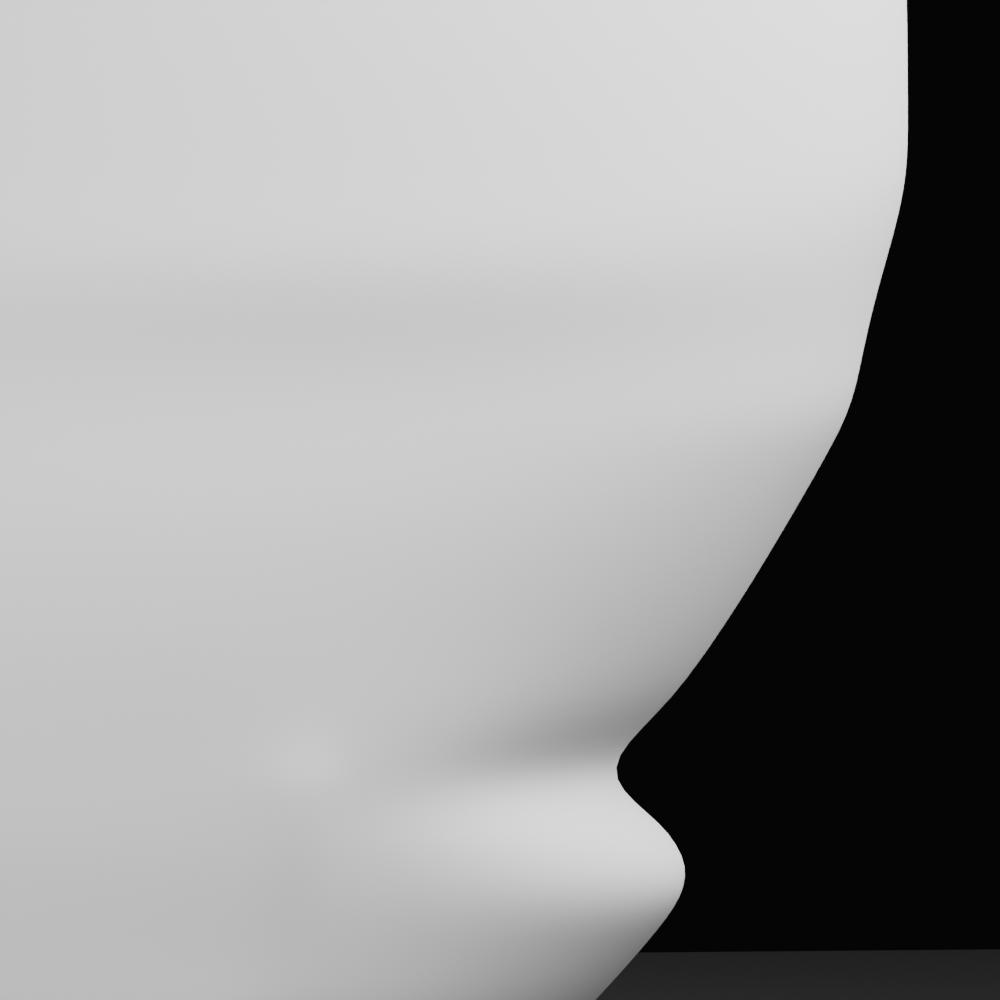
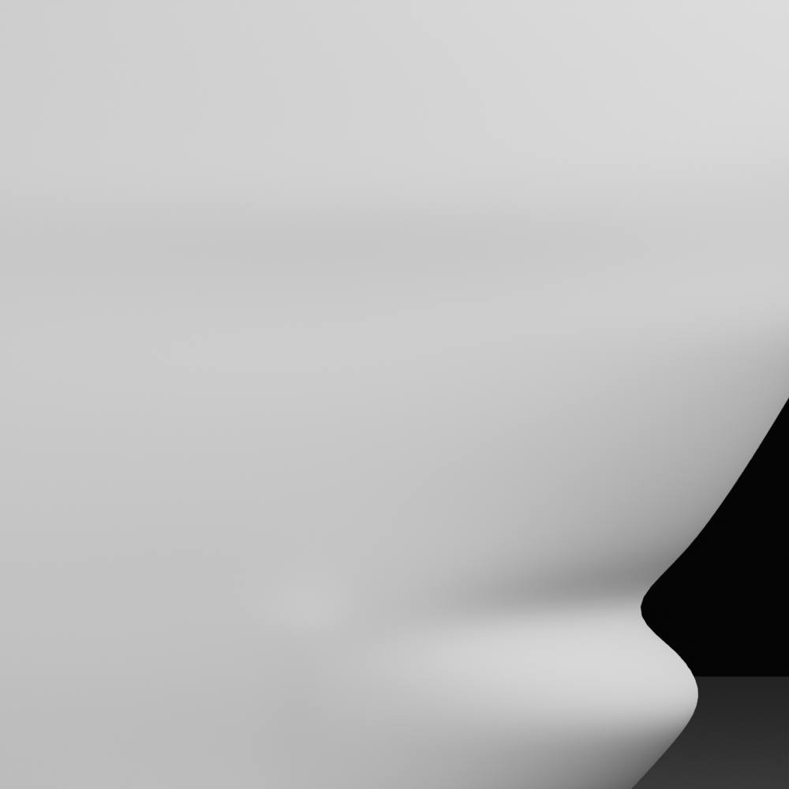

# Camille head-likeness references - 2026-11-05

**Purpose:** preserve a comparison and review record for historical head work. These renders are not modeling inputs for the current from-scratch build. None of the `.blend` files below is a geometry source for the full-body candidate.

## Candidate record

| Render revision | Source `.blend` in this repository | Source SHA-256 | Lineage | Existing review status | Ear status |
| --- | --- | --- | --- | --- | --- |
| v200 | [`Camille_Head_Ear_Fit_Test_v200_substantial_anatomy_pass.blend`](head-ear/Camille_Head_Ear_Fit_Test_v200_substantial_anatomy_pass.blend) | `E79C47EBAD55A0059AABC39016A098D0BD370C7BC04E1EE2E1E1598E2E0EA587` | Direct parent v194 | HOLD overall; A passed blockout readability, B/C unapproved. See [review](head-ear/REVIEW_v200_ear_anatomy.md). | Ear anatomy is unresolved; Y junction remains pinched and bowl transition ledge-like. |
| v210 | [`Camille_Head_Ear_Fit_Test_v210_marked_seam_flow.blend`](head-ear/Camille_Head_Ear_Fit_Test_v210_marked_seam_flow.blend) | `DE723AF530B80EF627E32021779466EFD473C16E18B52405E7A49D768D36B755` | Direct parent v209, on the v200 development branch | Split verdict: A/B PASS, C HOLD. See [review](head-ear/REVIEW_v210_ear_anatomy.md). | Outer placement stable; inner anatomy C remains held. |
| v221 fit candidate | Local archive filename `Camille_Head_Ear_Fit_Test_v221_front_arc_reference_fair.blend` (not included in this repository) | `415DE9838F01DAF3010B28704B1E083FB2F157D3A3F46151253E580D6B921D08` | Direct parent v220 (not included in this repository) | No independent verdict file located in the inspected source folder. | Ears present; front-arc refinement has renders but no recorded verdict. |
| v222 fit candidate | [`Camille_Head_Ear_Fit_Test_v222_front_outline_vertex_fit.blend`](head-ear/Camille_Head_Ear_Fit_Test_v222_front_outline_vertex_fit.blend) | `AEC92A8C74DDC39176A71938CD9C89DCA5FAE86C17C50E126F67768667D5C372` | Direct parent v200 | No independent verdict file located in the inspected source folder. | Ears present; front-outline candidate remains unreviewed. |
| v221 no-ear receiver | [`Camille_Head_Ear_Receiver_v221_no_ears.blend`](head-ear/Camille_Head_Ear_Receiver_v221_no_ears.blend) | `1BB1A0C344F3F22943C51EEFFB9B71CF97EBCCFCC6B867809E8BB994D797051B` | Direct parent v200; separate receiver branch, not a continuation approval of v222 | No fit verdict; it is a receiver intended for later replacement ear work. | No ears by design. |

The existing renders are clay blockouts, not completed facial likenesses. The user has directed the current model to be built from scratch from the open starter and the supplied body/face references. This historical comparison is retained for audit only; it is not a required input or authority for the current modeling pass.

## Matched view set

The views below are review images from each listed checkpoint, placed together for visual selection. They are not calibrated scans. Camera framing may differ slightly between revisions, so use them for likeness direction and revision context, not numeric measurement.

### v200 - overall review HOLD

| Front | Profile | Ear front | Ear side |
| --- | --- | --- | --- |
|  |  |  |  |

### v210 - split review, C held

| Front | Profile | Ear front | Ear side |
| --- | --- | --- | --- |
|  |  |  |  |

### v221 fit candidate - no verdict

| Front | Profile | Ear front | Ear side |
| --- | --- | --- | --- |
|  |  |  |  |

### v222 fit candidate - no verdict

| Front | Profile | Ear front | Ear side |
| --- | --- | --- | --- |
|  |  |  |  |

### v221 no-ear receiver - no fit verdict

| Front | Profile | Receiver front close | Receiver side close |
| --- | --- | --- | --- |
|  |  |  |  |

## Decision record

- Modeling-reference status: **excluded from the current from-scratch pass**.
- The supplied character sheet and face-reference image set are the active 2D appearance references.
- No prior head mesh or render is to be opened as a modeling input, appended, joined, copied, or used to place Blender geometry.
